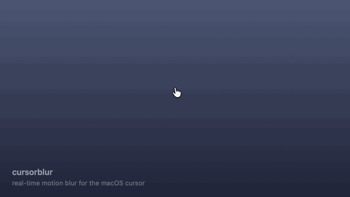

# cursorblur

Real-time motion blur for the macOS mouse cursor — runs at your display's refresh rate (120 Hz on ProMotion).

<p align="center"></p>

A single-file AppKit app (`cursorblur.swift`, no Xcode project) that hides the real cursor and redraws it with motion blur along its recent path, in a transparent click-through overlay on every screen.

## Install

1. Download **cursorblur-x.y.z.zip** from the [latest release](https://github.com/cpaulin94/cursorblur/releases/latest), unzip it and move **cursorblur.app** to Applications.
2. Open it. The release isn't notarized yet, so the first time macOS blocks it: go to **System Settings → Privacy & Security**, scroll down and click **Open Anyway**. Or, from Terminal:

   ```bash
   xattr -dr com.apple.quarantine /Applications/cursorblur.app && open /Applications/cursorblur.app
   ```

3. Use the **◐** icon in the menu bar for settings, **Launch at login** and Quit.

Universal app (Apple silicon and Intel), macOS 14 or later.

## Build from source

```bash
git clone https://github.com/cpaulin94/cursorblur.git && cd cursorblur && ./build.sh run
```

Build commands:

```bash
./build.sh run          # build and launch from the terminal
./build.sh app          # build build/cursorblur.app (universal: Apple silicon + Intel)
./build.sh release      # build, sign, notarize (if configured) and zip for distribution
```

To install as a regular app: `./build.sh app && cp -R build/cursorblur.app /Applications/`.
From the app's menu you can enable **Launch at login**.

### Signed releases

`./build.sh release` signs ad-hoc by default. With an Apple Developer ID it produces a
notarized, stapled zip that opens on any Mac without Gatekeeper warnings:

```bash
DEVELOPER_ID="Developer ID Application: Your Name (TEAMID)" \
NOTARY_PROFILE=your-notarytool-profile \
./build.sh release
```

Settings and Quit live in the **◐** menu bar icon.

**Requirements:** macOS 14+, Xcode Command Line Tools (`xcode-select --install`).
No Accessibility permission needed — it only reads `NSEvent.mouseLocation`.

## Settings

The menu shows a live preview of the current settings, a small diagram next to each
slider, and how much latency each one adds.

| Setting | What it does | Added pointer latency |
|---|---|---|
| Strength | Opacity of the trail | 0 ms |
| Trail length | How many past frames are smeared (1 frame = 8.3 ms at 120 Hz) | 0 ms. The trail covers past motion; the pointer itself is not delayed |
| Density | Spacing of the copies along the path (11 ≈ one every 1.5 pt): fast moves get more copies, slow ones fewer, so the trail stays smooth without turning muddy | 0 ms |
| Head bias | Fades the trail toward its tail | 0 ms |
| Movement threshold | Below this the cursor stays sharp; above it the trail fades in gradually | 0 ms |
| Hide real cursor | Shows only the cursor drawn by cursorblur | **1–2 frames** (≈ 8–17 ms at 120 Hz, 17–33 ms at 60 Hz) |
| Launch at login | Starts cursorblur automatically (app bundle only) | — |

Why only one setting adds latency: macOS draws the real cursor on a dedicated hardware
layer, updated at scan-out. Everything cursorblur draws goes through a normal window,
which the compositor shows on the next frame or the one after. With the real cursor
visible, that delay only affects the trail behind it. With the real cursor hidden, the
cursor you see is cursorblur's, so the delay applies to the pointer itself.

Settings persist in `UserDefaults`.

## How it works

- One borderless, transparent `NSWindow` per screen at `.cursorWindow` level, `ignoresMouseEvents = true`, joined to all Spaces.
- A `CADisplayLink` (`NSView.displayLink`, macOS 14+) ticks at the screen refresh rate, sampling the mouse position into a short history.
- The view draws N copies of `NSCursor.currentSystem` (respecting its hot spot) interpolated along that history, invalidating only the dirty rect.
- "Hide real cursor" uses the private `CGSSetConnectionProperty("SetsCursorInBackground")` + `CGDisplayHideCursor`, with balanced hide counts so the cursor is always restored on Quit, SIGINT/SIGTERM and app termination.

## Roadmap

- Notarized binary on GitHub Releases / Homebrew cask
- Metal renderer for very high sample counts

## License

MIT — see [LICENSE](LICENSE).
