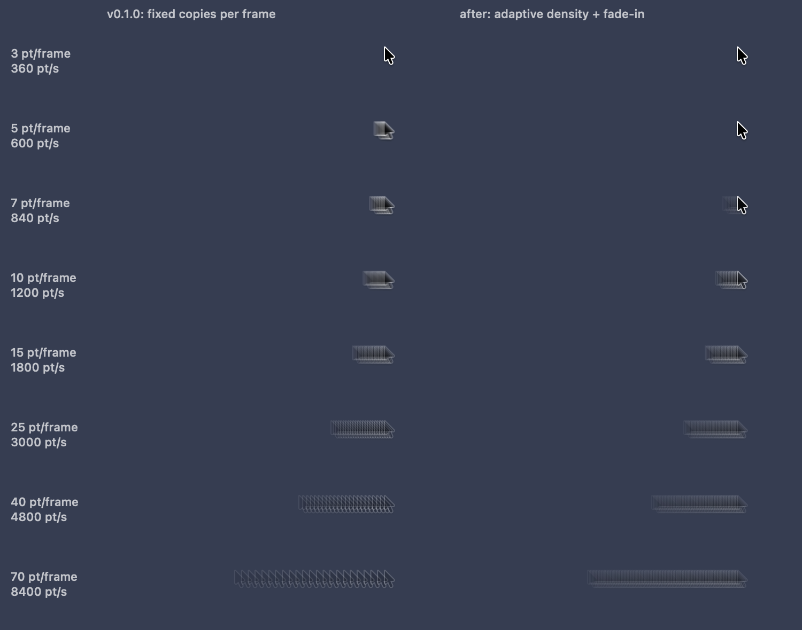
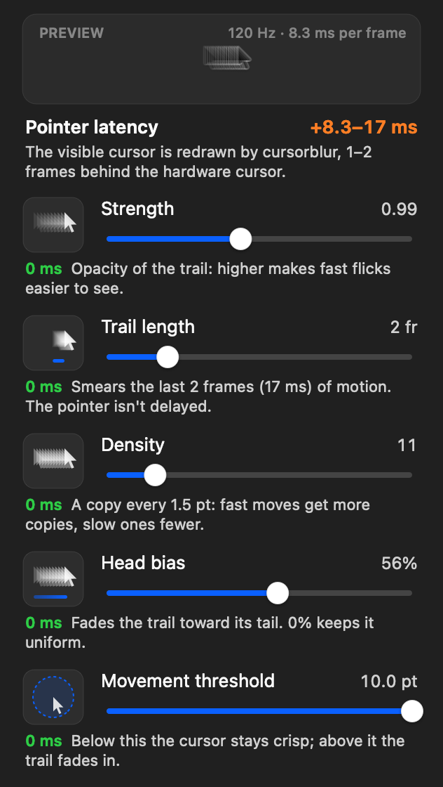

# Engineering notes

How cursorblur got from a working prototype to v0.1.1: the issues found while using it
every day, what caused them, and how each fix was verified.

Most of these never showed up in a quick test. They appeared only in a packaged app,
at the edge of a control, or at one specific mouse speed.

---

## Rendering

### Muddy trail at slow speeds, broken trail on fast flicks · v0.1.1

**Symptom.** Moving slowly, the cursor turned into a grey smudge. On fast flicks the
trail broke into a comb of separate arrows.

**Cause.** Every frame segment got the same number of copies (11), whatever the
distance travelled. On a 5 pt move 11 copies piled up in a few pixels, so the black
outlines covered the white fill. On a 70 pt flick the same 11 copies were 6 pt apart.

**Fix.**
- Copies are now spaced evenly along the path (the *Density* setting: one every ~1.5 pt
  by default). Fast segments get more copies and slow ones fewer, up to 128 per segment.
- Opacity is shared out across the copies, with a cap on how far it thins so fast flicks
  stay visible.
- Above the movement threshold the trail fades in over 16 pt instead of switching on at
  once, so slow, precise moves keep the cursor sharp.

**Verified.** An offscreen render of the trail at eight speeds, old algorithm against
new (`CURSORBLUR_RENDER_TRAILS=out.png`):

### Real cursor looked visible again in hide mode · regression, fixed before release

**Symptom.** After the menu redesign, *Hide real cursor* seemed to do nothing.

**Cause.** The real cursor *was* hidden. A refactor had started drawing the replacement
cursor fully opaque at every position, so the head no longer dissolved into its blur and
read as the real pointer with a trail behind it.

**Fix.** While moving, the head is again part of the blur. It is drawn sharp only once
the cursor stops. The menu preview follows the same rule.

**Verified.** Offscreen renders with hide mode on and off.

### Blurry cursor on Retina displays

**Cause.** The cursor image was rasterized at 1× and stretched on 2× screens.

**Fix.** The cursor is rasterized at the display's backing scale.

---

## Performance

### Stutter and lingering trails in the packaged app only

**Symptom.** Built from the terminal it was smooth. As a `.app` launched from Finder it
stuttered, and trails stayed on screen.

**Cause.** App Nap. A menu-bar-only app counts as idle, so macOS throttled its display
link. A process started from Terminal isn't napped, which is why it only happened in the
bundle.

**Fix.** A user-initiated, latency-critical activity, plus `NSAppSleepDisabled` in
Info.plist.

**Verified.** A frame-rate log (`CURSORBLUR_DEBUG=1`) on the installed app: a steady
120 fps while moving and at rest.

### A window-server round trip on every frame

**Cause.** `NSCursor.currentSystem` was called 120 times a second, and each call
returns a new image.

**Fix.** The cursor image is cached and refreshed every 3 frames. In hide mode it
refreshes every frame, because there the drawn cursor is the only one on screen.

---

## Cursor visibility

### Real cursor reappeared after switching apps

**Cause.** macOS resets the cursor's hide count on app switches, Dock and menu
interactions, and similar events. The app re-hid it only after its own menu closed.

**Fix.** Every ~125 ms the app checks whether the system cursor is visible again. If it
is, the app resets its count and hides it once more. The count stays balanced, so Quit,
SIGINT/SIGTERM and app termination always restore the cursor.

**Verified.** The cursor stayed hidden across repeated app switches and came back on
quit.

---

## Menu

### Slider stuck at its minimum

**Symptom.** Dragging a slider all the way left left its knob dark and unresponsive.

**Cause.** An `NSSlider` inside an `NSMenuItem` loses its mouse-up when the drag leaves
the menu, which is what happens when you drag past the left end to reach the minimum.
The slider stays in its pressed state forever.

**Fix.** A custom slider that tracks the drag in its own event loop, so it receives
every event until release, even outside the menu. It also supports scrolling and
VoiceOver.

**Verified.** A synthetic drag past the menu edge. Before the fix the value stuck at 4
and ignored later drags. After it: 24 → 4 → 22 → 4.

### Explaining what each control does, and what it costs

The menu shows a live preview of the current settings, a small diagram for each control
that changes with its value, and the pointer latency each setting adds:

Only *Hide real cursor* adds latency: 1–2 frames, ≈ 8–17 ms at 120 Hz. macOS draws the
real cursor on a hardware layer at scan-out, while anything an app draws goes through
the compositor. With the real cursor visible, that delay touches only the trail. It
shows up as a small gap between the cursor and its trail on fast flicks, which is also
why hiding the real cursor is the default.

---

## Tooling

- `CURSORBLUR_DEBUG=1`: logs the render rate once a second.
- `CURSORBLUR_RENDER_MENU=out.png`: renders the menu rows offscreen.
- `CURSORBLUR_RENDER_TRAILS=out.png`: renders the before/after trail comparison.
- `./build.sh release`: universal binary, Info.plist, signing (ad-hoc or Developer ID),
  optional notarization, zip and checksum.
